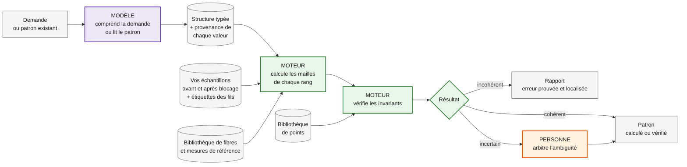

# knitproof

[](https://github.com/Isalafont/knitproof/actions/workflows/ci.yml)

> **Le modèle propose, le moteur prouve, la personne arbitre.**
> Generate, verify and validate knitting patterns with AI.

Demandez à un LLM un bonnet pour un enfant de 3 ans, en lui donnant le tour de tête, la laine, l’échantillon et la taille des aiguilles : il peut vous répondre avec un nombre de mailles de bonnet adulte. Le modèle ne calcule pas, il propose un nombre plausible. Et il ignore qu’un coton, peu élastique, ne se tricote pas avec la même aisance qu’un mérinos.

**knitproof ne fait pas confiance au modèle pour compter.** Le modèle comprend la demande ; un moteur déterministe calcule les mailles à partir de la mesure, de l’échantillon et du comportement de la fibre ; ce qui ne peut pas être calculé avec certitude revient à une personne.

## Ce que ça donne

### Calculer un patron

La demande :

```text
Bonnet pour un enfant de 3 ans
Tour de tête : 48 cm (mesuré)
Fil : 100 % mérinos superwash
Mon échantillon, aiguilles 4 mm, en jersey :
  avant blocage : 22 m pour 10 cm
  après blocage : 20 m pour 10 cm
Bord : côtes 2/2
```

Le calcul de knitproof :

```text
Échantillon  20 m / 10 cm, après blocage              source : votre échantillon
Aisance      −10 % : saisie, bonnet ajusté (à confirmer, question 1)
Tour visé    43,2 cm (48 × 0,90)
Montage      86,4 m calculées (43,2 × 20 / 10) → 88 m, multiple de 4 pour les côtes 2/2
             Tour fini réel : 44 cm

ATTENTION    Avec l’échantillon avant blocage (22 m), on monterait 96 m.
             Après lavage, le superwash se détend : 96 m donneraient 48 cm,
             sans aisance. Le bonnet glisserait.
             Décidé par : le moteur (calcul vérifiable)

REJETÉ       Proposition d’un LLM seul : 120 m
             Après blocage, 120 m donnent 60 cm (120 × 10 / 20) : un bonnet adulte.
             Décidé par : le moteur (calcul vérifiable)
```

*Résultat cible du jalon M1 ; valeur d’aisance saisie, à confirmer (question tricot 1).*

### Vos échantillons d’abord

Le moteur ne calcule qu’avec des valeurs dont il connaît l’origine, dans cet ordre de confiance :

1. **Votre échantillon**, mesuré avant et après blocage, avec la composition du fil et la taille des aiguilles. C’est la seule mesure qui reflète votre fil, vos aiguilles et votre main.
2. **L’étiquette du fil** : composition, échantillon et aiguilles conseillés par le fabricant, métrage, consignes de lavage. Une photo de l’étiquette suffit : le modèle la lit, le moteur s’en sert.
3. **La bibliothèque de fibres**, pour ce que l’échantillon et l’étiquette ne disent pas : élasticité, détente au lavage (forte pour un superwash).
4. **Les mesures de référence** par âge et par taille, quand la personne n’a pas pu être mesurée (par exemple, pour un tour de tête à 3 ans : environ 48 cm selon [Knit Picks](https://www.knitpicks.com/learning-center/hat-size-chart), 41 à 46 cm selon le [Craft Yarn Council](https://craftyarncouncil.com/node/39) ; les tableaux divergent, d’où l’intérêt de mesurer).
5. **Rien d’autre.** Une valeur manquante est demandée, jamais inventée.

Vos échantillons sont enregistrés et réutilisables d’un projet à l’autre.

### Vérifier un patron existant

Un extrait de patron de bonnet, avec une erreur glissée au rang 33 :

```text
Monter 108 m. Côtes 2/2 sur 20 rangs, puis jersey jusqu’au rang 30.
Rang 31 : *10 m end., 2 m ens.*, 9 fois (99 m)
Rang 32 : tout à l’endroit.
Rang 33 : *9 m end., 2 m ens.*, 9 fois (89 m)
```

Le rapport de knitproof, avec `uv run knitproof verify examples/bonnet-erreur-rang-33.yaml` (code de sortie 1) :

```text
ERREUR      Rang 33 — nombre de mailles incohérent
            Annoncé : 89 m · Calculé : 90 m
            Source : page 2, ligne 14
            Décidé par : le moteur (calcul vérifiable)
```

*Le rapport cible du jalon M1 va plus loin : les lignes « OK Montage » et « À VÉRIFIER Échantillon » arriveront avec `knitproof calc` (CLA-69), qui assemblera le montage (tranche 2) et l’échantillon (tranche 3) ; le détail « 99 − 9 diminutions » et la citation du texte source ne sont pas encore planifiés.*

## Comment c’est construit



En violet, le **modèle** : il comprend la demande ou lit le patron et produit une structure typée, jamais un nombre de mailles. En vert, le **moteur** : du Python pur, sans IA, qui calcule les mailles à partir de votre échantillon bloqué, de la mesure et de l’aisance selon le point et la fibre, puis vérifie les invariants (mailles avant et après, divisibilité des motifs). En orange, la **personne** : elle tranche ce qu’aucun calcul ne peut prouver.

La **bibliothèque de fibres** décrit le comportement de chaque matière (élasticité, mémoire, tendance à s’allonger) et sa part dans l’aisance, qui dépend aussi du point. Ses valeurs sont sourcées et validées par une personne qui tricote, jamais inventées par un modèle.

Pour aller plus loin : [l’architecture](docs/architecture.md) (qui décide quoi, couches, modèles de données, provenance), [le plan de réalisation](docs/plan.md) et [le protocole d’évaluation](docs/evaluation.md).

## Pourquoi on peut lui faire confiance

Parce qu’on le mesure. Sur les mêmes demandes, on compare un LLM seul et knitproof. Le calcul ne dépend d’aucun modèle : à demande identique, le résultat est identique. Ce qui varie d’un modèle à l’autre, c’est la lecture de la demande ou de l’étiquette, et c’est cela qu’on évalue, sur un jeu de cas dans lesquels des erreurs ont été injectées volontairement (taille confondue, échantillon non bloqué, répétition qui ne tombe pas juste, information absente) :

| Modèle | Montage correct, LLM seul | Montage correct, knitproof | Lecture juste | Champs inventés | Stabilité | Coût et temps |
|---|---|---|---|---|---|---|
| à venir (M2) | | | | | | |

Résultats publiés en k/N, sur un jeu de test jamais utilisé pour mettre au point les prompts ([protocole](docs/evaluation.md)).

Quand deux modèles, ou deux passages du même modèle, ne lisent pas la même valeur, le point passe en « À VÉRIFIER ». Les valeurs attendues des évaluations ne sont jamais modifiées pour faire passer un résultat.

## Feuille de route

| Jalon | Livrable |
|---|---|
| M0 — Cadrage | Plan détaillé, architecture, décisions documentées, conventions, intégration continue |
| M1 — Moteur | Calcul d’un bonnet à partir de la mesure, de vos échantillons (avant et après blocage) et de la fibre ; vérification d’un patron ; sans IA |
| M2 — Lecture et mesure | Lecture d’étiquettes en photo et de demandes par un modèle, fils recherchés sur Ravelry, évaluation chiffrée par modèle face à un LLM seul |
| M3 — Démo | Interface web accessible (RGAA), API, conteneur, déploiement continu |

Ensuite : lecture de patrons PDF, reconnaissance des points par photo, bibliothèque de points complète, génération de patrons, pulls raglan, gradation multi-tailles. Détail dans [le plan](docs/plan.md).

## Projets proches

- [StitchCheck](https://github.com/KingHaim/stitchcheck) vérifie déjà les mailles rang par rang, avec un mode LLM optionnel. knitproof se concentre sur ce qui manque : mesurer sa propre fiabilité, tracer la provenance de chaque valeur et renvoyer l’incertain à une personne.
- [knitcheck](https://github.com/jarhodes314/knitcheck) traite le patron comme un programme typé, en Rust.

## Développement

### Installer

Seul [uv](https://docs.astral.sh/uv/getting-started/installation/) est nécessaire : il installe lui-même Python 3.13 (fixé par `.python-version`) et les dépendances exactes de `uv.lock`.

```sh
git clone https://github.com/Isalafont/knitproof.git
cd knitproof
uv sync
uv run pre-commit install
uv run pytest
uv run ruff check .
uv run lint-imports
uv run mypy
```

`domain` et `engine` portent le modèle de patron et la vérification des comptes de mailles ; `app` et `cli` portent la commande `knitproof verify` ; les autres paquets de `src/knitproof/` sont vides pour l’instant. Ils fixent les contrats de couches, que `uv run lint-imports` vérifie. Les deux exemples de la section « Ce que ça donne » vivent dans `examples/` ; le test d’acceptation de `verify` passe ; celui de `calc` reste en échec attendu jusqu’à CLA-69, et la CI casse le jour où il passe sans qu’on retire le marqueur. Les patrons synthétiques justes vivent dans `examples/synthetiques/`, et la CI les vérifie tous.

Pour les données Ravelry, copier `.env.example` en `.env` et y renseigner ses identifiants d’API. Le fichier `.env` n’est jamais versionné.

### Vérifier un patron YAML

La commande `knitproof verify` vérifie les comptes de mailles d’un fichier au format décrit dans [`docs/architecture.md`](docs/architecture.md), section 9. Un patron réel se range dans `local-patterns/`, que git ignore : il ne quitte pas votre machine et aucun test de la CI ne le lit.

```sh
uv run knitproof verify local-patterns/mon-bonnet.yaml
```

Le rapport sort sur stdout. Le code de sortie dit le résultat :

- `0` : aucun constat ;
- `1` : au moins un constat, rapporté sur stdout ;
- `2` : erreur d’usage (par exemple, fichier non précisé), message sur stderr ;
- `3` : fichier absent, illisible ou invalide, message sur stderr, sans trace Python.

Pour vérifier plusieurs fichiers d’un coup, un test à la demande lit ceux que désigne `KNITPROOF_PATTERNS`. Depuis la racine du dépôt, un fichier, puis tous ceux d’un dossier (motif glob, entre apostrophes pour que le shell ne le développe pas) :

```sh
KNITPROOF_PATTERNS=local-patterns/mon-bonnet.yaml uv run pytest tests/test_pattern_files.py
KNITPROOF_PATTERNS='local-patterns/*.yaml' uv run pytest tests/test_pattern_files.py
```

Lire le résultat :

- `1 passed` : aucun constat, chaque compte annoncé est celui que calcule le moteur.
- `1 failed` : une ligne par constat, le fichier, puis le même bloc que `knitproof verify`, avec le rang. Par exemple, sur `examples/bonnet-erreur-rang-33.yaml` : `Rang 33 — nombre de mailles incohérent`, puis `Annoncé : 89 m · Calculé : 90 m`. Pour un `repeat_not_fitting`, le bloc donne les mailles laissées par le rang précédent et celles que consomment les opérations ; la simulation s’arrête à ce rang.
- Un motif qui ne trouve aucun fichier, ou un fichier invalide (opération inconnue, clé en trop), échoue avec la raison.
- Sans la variable, le test est sauté (`1 skipped`) : `uv run pytest` ne lit jamais `local-patterns/`. Préfixer la commande, ne pas exporter la variable.

Limites :

- Seules `work`, `k2tog`, `m1` et `repeat` sont prises en charge ; les diminutions des patrons synthétiques sont toutes écrites en `k2tog`. Un fichier qui emploie une autre opération est rejeté, et ce rejet ne prouve pas une erreur de calcul.
- Le multiple du point (côtes 2/2…) n’est pas vérifié : la commande et le test comptent les mailles, ils ne contrôlent pas le montage. Le moteur calcule et contrôle le montage d’un seul point (multiple et reste), au plus proche, en dessous en cas d’égalité, mais `knitproof verify` ne le vérifie pas et aucune commande ne l’expose avant CLA-69. Le rang d’ajustement entre bord et corps relève de CLA-103.
- Après un `repeat_not_fitting`, les comptes annoncés suivants ne sont pas comparés ([ADR 0013](docs/adr/0013-format-yaml-fige-et-poursuite-sur-le-compte-calcule.md)).
- Seuls les comptes de mailles sont vérifiés : ni mesures, ni échantillon.

Les patrons synthétiques justes de `examples/synthetiques/` sont vérifiés par la CI à chaque `uv run pytest`, sans variable.

### Contribuer

- `main` est la production, `develop` l’intégration déployée sur la sandbox.
- Chaque changement part de `develop` sur sa propre branche et y revient par une pull request ; `develop` passe sur `main` par une pull request.
- `main` et `develop` sont protégées : pas de push direct, une pull request ne merge que si la CI est verte (tests, `ruff check`, `ruff format --check`, `lint-imports`, `mypy`). `main` n’accepte que des pull requests depuis `develop`.
- GitHub supprime la branche distante au merge ; en local, `git fetch -p` puis `git branch -d <branche>`.
- Une pull request met à jour ce README et `docs/` quand elle change un comportement, une commande ou une décision.
- ruff vérifie aussi le nommage (`N`), le style pytest (`PT`), ses propres règles (`RUF`) et les nombres magiques dans `src/` (`PLR2004`) ; l’apostrophe typographique et les espaces insécables sont permis. mypy refuse `Any` ([ADR 0012](docs/adr/0012-interdire-any-avec-mypy.md)). Les conventions que les outils ne vérifient pas sont dans `AGENTS.md`.

Python 3.13, uv, pytest, Hypothesis, ruff, mypy strict, import-linter, pre-commit. Décisions d’architecture dans [`docs/adr/`](docs/adr/).

### Travailler avec les agents

- Les règles de tous les agents sont dans [`AGENTS.md`](AGENTS.md), que `CLAUDE.md` importe.
- Avec Claude Code, `/plan-ticket CLA-XX` passe le ticket en « In Progress », puis prépare son contexte et son plan (questions une par une, deux relectures, arbitrage, ticket réaligné), sans écrire de code ; le rédacteur et le vérificateur lisent aussi les tickets directement liés. Le ticket réaligné suit le template de son type (US, TS, Bug, Cadrage), versionné dans `.claude/skills/plan-ticket/templates/` ; à la publication, il coche la DOR.
- `/implement-slice CLA-XX` fait implémenter le plan validé par un modèle plus léger, un commit par étape ; la session revérifie, coche les cases producteur du ticket Linear, pousse et ouvre la PR, passe le ticket en « In Review » quand la CI est verte, puis, après le « ok » d’Isabelle sur le test, coche les cases testeur et la DOD et merge. Chaque case est cochée sur preuve, et toute autre écriture dans Linear que ces deux changements de statut attend l’accord d’Isabelle.
- Les plans restent locaux dans `.claude/plans/` ; `.claude/settings.json` pré-autorise les commandes courantes (détail dans `AGENTS.md`).

## Licence

MIT — Isabelle Lafont
