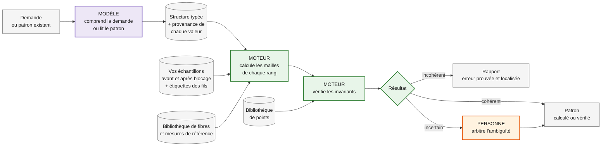

<div align="center">

<picture>
  <source media="(prefers-color-scheme: dark)" srcset="docs/images/logo-dark.svg">
  
</picture>

<br><br>

**Le modèle propose, le moteur prouve, la personne arbitre.**

Knitting patterns computed and checked by a deterministic engine, not guessed by an AI.

**knitproof** calcule et vérifie les mailles de patrons de tricot, en commençant par le bonnet. Aujourd’hui, `knitproof calc` calcule un bonnet depuis une demande YAML et `knitproof verify` contrôle les comptes de mailles d’un patron écrit en YAML.

[](https://github.com/Isalafont/knitproof/actions/workflows/ci.yml)
[](pyproject.toml)
[](#licence)

[Vidéo](#vidéo) · [Pourquoi knitproof](#pourquoi-knitproof-) · [Ce que ça donne](#ce-que-ça-donne) · [Installer](#installer) · [Vérifier un patron YAML](#vérifier-un-patron-yaml) · [Architecture](docs/architecture.md) · [Feuille de route](#feuille-de-route)

</div>

Principes : un calcul déterministe, jamais confié au modèle · une provenance pour chaque valeur · l’incertain renvoyé à une personne · une fiabilité mesurée, pas promise.

<details>
<summary>In English</summary>

knitproof computes and checks knitting patterns, starting with hats. A language model may read the request or the pattern, but it never produces a stitch count: a deterministic Python engine computes every number from the measurement, the gauge (a blocked swatch first, the yarn label as a flagged fallback) and the yarn’s swatch, and whatever it cannot prove goes back to a person. Every value carries its provenance. Status, November 2026: `knitproof calc` computes a hat from a request written in YAML and `knitproof verify` checks the stitch counts of a pattern written in YAML; model-based reading is planned. The rest of this README is in French.

</details>

## Vidéo

<p align="center"><em>Visite guidée de l’architecture de knitproof.</em></p>

https://github.com/user-attachments/assets/f519c0bd-ee64-499b-ba66-d231b98dff74

## Pourquoi knitproof ?

Un LLM à qui l’on demande un bonnet répond avec un nombre de mailles plausible : il ne le calcule pas. Une erreur de taille, un échantillon non bloqué, une fibre qui se détend au lavage, et le bonnet ne va à personne.

- **Pour les tricoteuses** : un nombre de mailles calculé à partir de votre échantillon, et un avertissement quand il ne suffit pas.
- **Pour les contributeurs** : un cœur en Python pur, des couches contrôlées et des tests qui n’ont pas besoin d’un modèle.
- **Pour les curieux de l’IA fiable** : un modèle qui lit, un moteur qui prouve, et une fiabilité mesurée ([voir plus bas](#pourquoi-on-peut-lui-faire-confiance)).

## Fonctionnalités

<table>
<tr>
<td width="50%" valign="top">

**Moteur prouvé**<br>
Calcul en décimal exact ; aucun nombre venu du modèle n’entre dans un patron.

</td>
<td width="50%" valign="top">

**Provenance de chaque valeur**<br>
Chaque valeur dit d’où elle vient : votre échantillon, l’étiquette, la bibliothèque ou une décision.

</td>
</tr>
<tr>
<td valign="top">

**Votre échantillon d’abord**<br>
Le calcul part de votre jauge, de préférence mesurée après blocage ; sans échantillon, il suit l’étiquette, « À VÉRIFIER » ; avec un échantillon, il signale l’écart à l’étiquette dès 5 %. `knitproof calc` calcule le bonnet depuis une demande YAML et contrôle le montage proposé. Disponible.

</td>
<td valign="top">

**Vérifier un patron existant**<br>
`knitproof verify` contrôle les comptes de mailles d’un patron YAML et localise l’erreur. Disponible.

</td>
</tr>
<tr>
<td valign="top">

**Bibliothèque sourcée**<br>
Tailles d’aiguilles US, UK et JP, tour de tête par âge, aisance : chaque valeur cite sa source.

</td>
<td valign="top">

**Une personne arbitre l’incertain**<br>
Ce que le moteur ne peut pas prouver passe en « À VÉRIFIER » et revient à une personne. La lecture d’une demande ou d’une étiquette par un modèle est prévue (jalon M2).

</td>
</tr>
</table>

## knitproof, un LLM seul ou un calculateur ?

| | knitproof | LLM seul | Calculateur de mailles classique |
|---|---|---|---|
| Comprend une demande en langage naturel | prévu (M2) | oui | non |
| Calcule juste | oui, moteur déterministe | non garanti | oui |
| Tient compte de la fibre et du blocage | oui | rarement | non |
| Dit d’où vient chaque valeur | oui | non | non |
| Renvoie l’incertain à une personne | oui | non | non |

Le calculateur classique calcule juste mais ne comprend pas la demande ; le LLM comprend mais ne calcule pas. knitproof vise les deux, la preuve en plus (voir [Pourquoi on peut lui faire confiance](#pourquoi-on-peut-lui-faire-confiance)).

Demandez à un LLM un bonnet pour un enfant de 3 ans, en lui donnant le tour de tête, la laine, l’échantillon et la taille des aiguilles : il peut vous répondre avec un nombre de mailles de bonnet adulte. Le modèle ne calcule pas, il propose un nombre plausible. Et il ignore qu’un coton, peu élastique, ne se tricote pas avec la même aisance qu’un mérinos.

**knitproof ne fait pas confiance au modèle pour compter.** Le modèle comprend la demande ; un moteur déterministe calcule les mailles à partir de la mesure, de l’échantillon de la laine ; ce qui ne peut pas être calculé avec certitude revient à une personne.

## Ce que ça donne

### Calculer un patron

La demande :

```text
Bonnet pour un enfant de 3 ans
Tour de tête : 48 cm (mesuré)
Fil : 100 % mérinos superwash
Mon échantillon, aiguilles 4 mm, en jersey :
  avant blocage : 22 m pour 10 cm
  après blocage : 20 m pour 10 cm
  30 rangs pour 10 cm, avant et après blocage (À VÉRIFIER, d’après DROPS 49-25)
Bord : côtes 2/2, revers de 5 cm replié
Hauteur finie : 20 cm
```

Le calcul de knitproof, avec `uv run knitproof calc examples/bonnet-3-ans.yaml` (code de sortie 0) :

<!-- sortie : examples/sorties/bonnet-3-ans.calc.txt -->
```text
Échantillon 20 m / 10 cm, après blocage (source : votre échantillon)
Aisance     −10 % : saisie
Tour visé   43,2 cm (48 × 0,9)
Montage     86,4 m calculées (43,2 × 20 / 10) → 88 m, multiple de 4
            Tour fini réel : 44 cm
Hauteur     20 cm finis + 5 cm de revers = 25 cm tricotés : 75 rangs (30 rangs / 10 cm, À VÉRIFIER, d’après DROPS Children 49-25)
Bord        30 rangs (le revers se tricote deux fois : 2 × 5 cm)
Calotte     17 rangs, 10 rangs de diminution, 8 m restantes, environ 5,7 cm
Corps       28 rangs (75 − 30 − 17)
Aiguilles   4 mm

ALERTE      Avec l’échantillon avant blocage (22 m), on monterait 96 m.
            96 m donneraient 48 cm après blocage, sans aisance.
            Décidé par : le moteur (calcul vérifiable)

REJETÉ      Proposition d’un LLM seul : 120 m
            120 m diffèrent du montage calculé : 88 m
            Après blocage, 120 m donnent 60 cm (120 × 10 / 20)
            Décidé par : le moteur (calcul vérifiable)
```

L’aisance est une valeur saisie. Le moteur compare le montage sur l’échantillon avant blocage (96 m, 48 cm après lavage) et rejette le nombre proposé par un LLM (120 m, 60 cm : un bonnet adulte).

À plat, le même bonnet se monte sur 90 m (88 m plus une lisière à chaque bord), avec les diminutions de la calotte à l’endroit seulement : 19 rangs de calotte au lieu de 17, et un corps réglé pour que la calotte commence à l’endroit ([ADR 0028](docs/adr/0028-rangs-du-bonnet-et-bonnet-a-plat.md)). Hauteurs et jauge en rangs de l’exemple : « À VÉRIFIER ». Le changement d’aiguille dans la calotte se calcule sur la dernière aiguille saisie, celle de la calotte.

### Vos échantillons d’abord

Le moteur ne calcule qu’avec des valeurs dont il connaît l’origine, dans cet ordre de confiance :

1. **Votre échantillon**, mesuré avant et après blocage, avec la composition du fil et la taille des aiguilles. C’est la seule mesure qui reflète votre fil, vos aiguilles et votre main.
2. **L’étiquette du fil** : composition, échantillon et aiguilles conseillés par le fabricant, métrage, consignes de lavage. Une photo de l’étiquette suffit : le modèle la lit, le moteur s’en sert.
3. **La bibliothèque de fibres**, un vocabulaire qui dit quels noms désignent une même fibre ; le comportement au lavage ne vient pas de la fibre mais de l’échantillon tricoté de la laine ([ADR 0030](docs/adr/0030-laines-de-reference.md)).
4. **Les mesures de référence** par âge et par taille, quand la personne n’a pas pu être mesurée. Pour un tour de tête, la plage par âge vient de patrons (DROPS Children, Julie Taylor) jusqu’à 14 ans, puis du [Craft Yarn Council](https://www.craftyarncouncil.com/standards/head-circumference-chart), femme et homme, dès 15 ans ; elle reste « À VÉRIFIER », sans valeur proposée (à 3 ans : 50 à 52 cm) ([ADR 0027](docs/adr/0027-tour-de-tete-par-age-d-apres-les-patrons.md)). Les tableaux du tricot divergent : 19 in (environ 48 cm) pour « 12 mois à 3 ans » selon [Knit Picks](https://tutorials.knitpicks.com/hat-size-charts/). D’où l’intérêt de mesurer. La grille de tailles nommées reste décrite dans l’[ADR 0026](docs/adr/0026-grille-de-tailles-du-tour-de-tete.md).
5. **Rien d’autre.** Une valeur manquante est demandée, jamais inventée.

Vos échantillons sont enregistrés et réutilisables d’un projet à l’autre.

### Vérifier un patron existant

Un extrait de patron de bonnet, avec une erreur glissée au rang 33 :

```text
Monter 108 m. Côtes 2/2 sur 20 rangs, puis jersey jusqu’au rang 30.
Rang 31 : *10 m end., 2 m ens.*, 9 fois (99 m)
Rang 32 : tout à l’endroit.
Rang 33 : *9 m end., 2 m ens.*, 9 fois (89 m)
```

Le rapport de knitproof, avec `uv run knitproof verify examples/bonnet-erreur-rang-33.yaml` (code de sortie 1) :

<!-- sortie : examples/sorties/bonnet-erreur-rang-33.verify.txt -->
```text
ERREUR      Rang 33 — nombre de mailles incohérent
            Annoncé : 89 m · Calculé : 90 m
            Source : page 2, ligne 14
            Décidé par : le moteur (calcul vérifiable)
```

## Comment c’est construit



En violet, le **modèle** : il comprend la demande ou lit le patron et produit une structure typée, jamais un nombre de mailles. En vert, le **moteur** : du Python pur, sans IA, qui calcule les mailles à partir de votre échantillon bloqué, de la mesure et de l’aisance selon l’ajustement voulu et le point, puis vérifie les invariants (mailles avant et après, divisibilité des motifs). En orange, la **personne** : elle tranche ce qu’aucun calcul ne peut prouver.

La **bibliothèque de fibres** est un vocabulaire : elle ne porte ni détente ni avertissement, le comportement venant de l’échantillon de la laine ([ADR 0030](docs/adr/0030-laines-de-reference.md)). La part de l’aisance vient d’une table par ajustement et par point ([ADR 0024](docs/adr/0024-aisance-du-bonnet.md)), lue d’après plusieurs patrons selon le point de l’échantillon et la famille de la laine (fibre majoritaire et superwash), avec une base de −5 % faute de source ([ADR 0031](docs/adr/0031-aisance-d-apres-les-patrons-et-la-laine.md)). Ses noms viennent des étiquettes et c’est Isabelle qui décide lesquels désignent une même fibre.

![Carte du code de knitproof. La commande knitproof (couche cli) passe par les cas d’usage (app), qui appellent le moteur de calcul (engine) et la bibliothèque de référence (library) ; tous dépendent du vocabulaire du tricot (domain), qui ne dépend d’aucune autre couche. Les dépendances vont toujours vers le bas, jamais l’inverse. Le tout s’appuie sur Pydantic et un lecteur YAML ; les tests (pytest et Hypothesis) couvrent chaque bloc ; les couches api, web, llm et sources sont réservées et encore vides ; evals garde les cas d’évaluation.](docs/images/architecture.png)

*Carte du code au 9 novembre 2026 : chaque bloc est une partie du code, chaque trait un import. Elle est générée en local avec [Floorplan](https://github.com/haydenschmitty/floorplan) dans `floorplan/`, hors du dépôt, et se refait quand le code change. Cliquer sur l’image l’ouvre en taille réelle. Le détail des couches est dans [l’architecture](docs/architecture.md).*

Pour aller plus loin : [l’architecture](docs/architecture.md) (qui décide quoi, couches, modèles de données, provenance), [le plan de réalisation](docs/plan.md) et [le protocole d’évaluation](docs/evaluation.md).

## Pourquoi on peut lui faire confiance

Parce qu’on le mesure. Sur les mêmes demandes, on compare un LLM seul et knitproof. Le calcul ne dépend d’aucun modèle : à demande identique, le résultat est identique. Ce qui varie d’un modèle à l’autre, c’est la lecture de la demande ou de l’étiquette, et c’est cela qu’on évalue, sur un jeu de cas dans lesquels des erreurs ont été injectées volontairement (taille confondue, échantillon non bloqué, répétition qui ne tombe pas juste, information absente) :

| Modèle | Montage correct, LLM seul | Montage correct, knitproof | Lecture juste | Champs inventés | Stabilité | Coût et temps |
|---|---|---|---|---|---|---|
| à venir (M2) | | | | | | |

Résultats publiés en k/N, sur un jeu de test jamais utilisé pour mettre au point les prompts ([protocole](docs/evaluation.md)).

Quand deux modèles, ou deux passages du même modèle, ne lisent pas la même valeur, le point passe en « À VÉRIFIER ». Les valeurs attendues des évaluations ne sont jamais modifiées pour faire passer un résultat.

## Feuille de route

| Jalon | Livrable |
|---|---|
| M0 — Cadrage | Plan détaillé, architecture, décisions documentées, conventions, intégration continue |
| M1 — Moteur | Calcul d’un bonnet à partir de la mesure, de vos échantillons (avant et après blocage) et de l’échantillon de la laine ; vérification d’un patron ; sans IA |
| M2 — Lecture et mesure | Lecture d’étiquettes en photo et de demandes par un modèle, fils recherchés sur Ravelry, évaluation chiffrée par modèle face à un LLM seul |
| M3 — Démo | Interface web accessible (RGAA), API, conteneur, déploiement continu |

Ensuite : lecture de patrons PDF, reconnaissance des points par photo, bibliothèque de points complète, génération de patrons, pulls raglan, gradation multi-tailles. Détail dans [le plan](docs/plan.md).

## Projets proches

- [StitchCheck](https://github.com/KingHaim/stitchcheck) vérifie déjà les mailles rang par rang, avec un mode LLM optionnel. knitproof se concentre sur ce qui manque : mesurer sa propre fiabilité, tracer la provenance de chaque valeur et renvoyer l’incertain à une personne.
- [knitcheck](https://github.com/jarhodes314/knitcheck) traite le patron comme un programme typé, en Rust.

## Développement

### Installer

Seul [uv](https://docs.astral.sh/uv/getting-started/installation/) est nécessaire : il installe lui-même Python 3.13 (fixé par `.python-version`) et les dépendances exactes de `uv.lock`.

```sh
git clone https://github.com/Isalafont/knitproof.git
cd knitproof
uv sync
uv run pre-commit install
uv run pytest
uv run ruff check .
uv run lint-imports
uv run mypy
```

### Calculer un bonnet

La commande `knitproof calc` lit une demande YAML, calcule le plan du bonnet et contrôle le montage proposé.

```sh
uv run knitproof calc examples/bonnet-3-ans.yaml
```

Codes de sortie, formats et limites : [docs/commandes.md](docs/commandes.md).

### Vérifier un patron YAML

La commande `knitproof verify` vérifie les comptes de mailles d’un patron écrit en YAML.

```sh
uv run knitproof verify local-patterns/mon-bonnet.yaml
```

Codes de sortie, formats et limites : [docs/commandes.md](docs/commandes.md).

Les modèles (Anthropic, Mistral) se configurent par l’environnement : voir « Modèles » dans [docs/commandes.md](docs/commandes.md).

### Contribuer

- `main` est la production, `develop` l’intégration déployée sur la sandbox ; chaque changement part de `develop` sur sa propre branche `feature/*` et y revient par une pull request.
- `main` et `develop` sont protégées : pas de push direct, une pull request ne merge que si la CI est verte (tests, `ruff check`, `ruff format --check`, `lint-imports`, `mypy`). `main` n’accepte que des pull requests depuis `develop`.
- Une pull request met à jour ce README et `docs/` quand elle change un comportement, une commande ou une décision.

Python 3.13, uv, pytest, Hypothesis, ruff, mypy strict, import-linter, pre-commit. Décisions d’architecture dans [`docs/adr/`](docs/adr/).

### Travailler avec les agents

Le projet se développe avec des agents de code, encadrés par des règles écrites ([`AGENTS.md`](AGENTS.md)) :

- `/plan-ticket CLA-XX` : questions métier, contexte et plan relus par deux agents, une seule validation humaine.
- `/implement-slice CLA-XX` : un agent code étape par étape, un autre relit le diff, preuves à l’appui ; le merge attend le test humain.
- `/orchestrate` : plusieurs tickets en parallèle, chacun dans son worktree.

Le détail (statuts Linear, cadrages, rebase) est dans [`AGENTS.md`](AGENTS.md) et `.claude/skills/`.

## Licence
MIT — Isabelle Lafont
