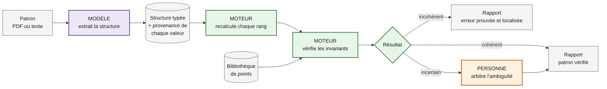

# knitproof

> **Le modèle propose, le moteur prouve, la personne arbitre.**
> Generate, verify and validate knitting patterns with AI.

Un patron de tricot est un programme : chaque rang transforme un nombre de mailles en un autre. Une seule maille perdue, et le bonnet ne se ferme plus. Les LLM savent lire et rédiger des patrons, mais ils inventent volontiers des nombres.

**knitproof ne fait pas confiance au modèle pour compter.** Le modèle lit le patron ; un moteur déterministe recalcule chaque rang ; ce qui ne peut pas être prouvé revient à une personne.

## Ce que ça donne

Un extrait de patron de bonnet, avec une erreur glissée au rang 33 :

```text
Monter 108 m. Côtes 2/2 sur 20 rangs, puis jersey jusqu’au rang 30.
Rang 31 : *10 m end., 2 m ens.*, 9 fois (99 m)
Rang 32 : tout à l’endroit.
Rang 33 : *9 m end., 2 m ens.*, 9 fois (89 m)
```

Le rapport de knitproof :

```text
ERREUR      Rang 33 — nombre de mailles incohérent
            Annoncé : 89 m · Calculé : 90 m (99 − 9 diminutions)
            Source : « *9 m end., 2 m ens.*, 9 fois », page 2, ligne 14
            Décidé par : le moteur (calcul vérifiable)

OK          Montage — 108 m compatibles avec les côtes 2/2 (multiple de 4)

À VÉRIFIER  Échantillon mesuré en jersey ; les côtes resserrent le bord.
            La largeur finale n’est pas calculable avec certitude.
            Décidé par : une personne
```

*Rapport cible du jalon M1 : le moteur est en cours de construction.*

## Comment c’est construit



En violet, le **modèle** : il lit le patron et produit une structure typée, jamais un verdict. En vert, le **moteur** : du Python pur, sans IA, qui recalcule chaque rang et vérifie les invariants (mailles avant et après, divisibilité des motifs, cohérence avec l’échantillon). En orange, la **personne** : elle tranche ce qu’aucun calcul ne peut prouver.

## Pourquoi on peut lui faire confiance

Parce qu’on le mesure. knitproof est évalué sur un jeu de patrons dans lesquels des erreurs ont été injectées volontairement (augmentation oubliée, mauvais rang, répétition qui ne tombe pas juste) :

| Mesure | Résultat |
|---|---|
| Erreurs détectées | à venir (M2) |
| Fausses alertes | à venir (M2) |
| Coût et temps par patron | à venir (M2) |

Les valeurs attendues des évaluations ne sont jamais modifiées pour faire passer un résultat.

## Feuille de route

| Jalon | Livrable |
|---|---|
| M0 — Cadrage | Plan détaillé, architecture, décisions documentées |
| M1 — Moteur | Calcul et vérification d’un bonnet, sans IA |
| M2 — Lecture et mesure | Extraction depuis un PDF par un modèle, évaluation chiffrée |
| M3 — Démo | Interface web accessible (RGAA), API, conteneur, intégration continue |

Ensuite : reconnaissance des points par photo, bibliothèque de points complète, génération de patrons, pulls raglan, gradation multi-tailles.

## Projets proches

- [StitchCheck](https://github.com/KingHaim/stitchcheck) vérifie déjà les mailles rang par rang, avec un mode LLM optionnel. knitproof se concentre sur ce qui manque : mesurer sa propre fiabilité, tracer la provenance de chaque valeur et renvoyer l’incertain à une personne.
- [knitcheck](https://github.com/jarhodes314/knitcheck) traite le patron comme un programme typé, en Rust.

## Développement

```sh
uv sync
uv run pytest
uv run ruff check .
```

Python 3.13, [uv](https://docs.astral.sh/uv/), pytest, ruff. Décisions d’architecture dans [`docs/adr/`](docs/adr/).

## Licence

MIT — Isabelle Lafont
