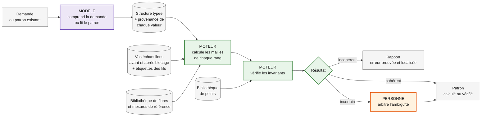
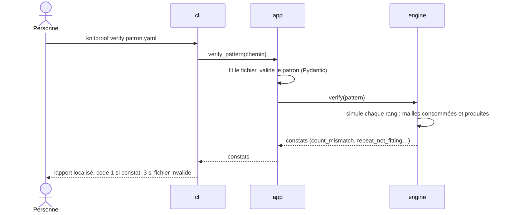
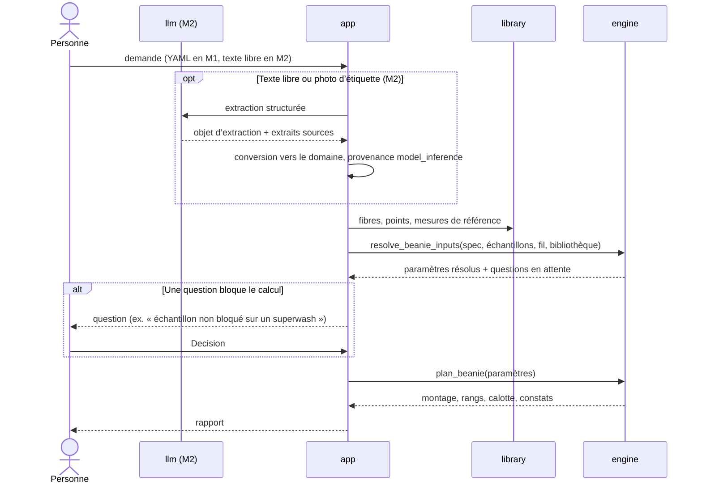
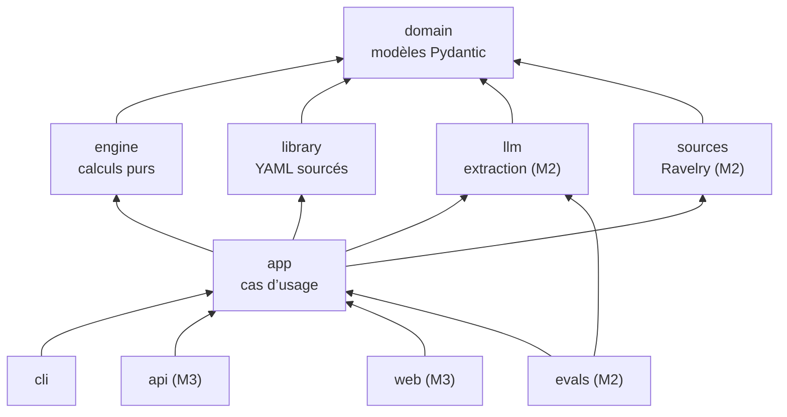

# Architecture de knitproof

> **Le modèle propose, le moteur prouve, la personne arbitre.**

Ce document décrit comment knitproof est construit : qui décide quoi, par où passent les données, comment le code est découpé et pourquoi. Le plan de réalisation est dans [`plan.md`](plan.md), le protocole d’évaluation dans [`evaluation.md`](evaluation.md).

## Sommaire

1. [Vue d’ensemble](#1-vue-densemble)
2. [Qui décide quoi](#2-qui-décide-quoi)
3. [Parcours « vérifier un patron »](#3-parcours--vérifier-un-patron-)
4. [Parcours « calculer un bonnet »](#4-parcours--calculer-un-bonnet-)
5. [Couches](#5-couches)
6. [Modèles de données](#6-modèles-de-données)
7. [Provenance et résolution des sources](#7-provenance-et-résolution-des-sources)
8. [Nombres et arrondis](#8-nombres-et-arrondis)
9. [Représentation d’un patron](#9-représentation-dun-patron)
10. [Sécurité et données](#10-sécurité-et-données)
11. [Limites assumées](#11-limites-assumées)
12. [Décisions à documenter](#12-décisions-à-documenter)
13. [Projets proches](#13-projets-proches)

## 1. Vue d’ensemble



Trois acteurs, trois responsabilités qui ne se recouvrent pas :

- le **modèle** (violet) transforme du texte ou une image en structure typée ; il ne produit jamais un nombre de mailles ni un verdict ;
- le **moteur** (vert) est du Python pur, sans IA : il résout les sources, calcule, simule et vérifie ;
- la **personne** (orange) tranche ce qu’aucun calcul ne peut prouver, et sa décision est enregistrée.

## 2. Qui décide quoi

| Étape | Modèle | Moteur | Personne |
|---|---|---|---|
| Comprendre une demande, lire une étiquette (M2) | propose une structure | valide le schéma, pose la provenance | corrige si besoin |
| Résoudre les paramètres (échantillon, tour de tête, aisance, hauteur) | — | applique la table de résolution | répond aux questions en attente |
| Calculer montage, hauteur, calotte | — | calcule | — |
| Vérifier un patron | — | simule rang par rang, compare | — |
| Contrôler un nombre proposé par un LLM | — | accepte ou rejette, avec le calcul | — |
| Trancher une ambiguïté | — | signale `needs_review` | décide ; la `Decision` est tracée |
| Juger tombé, confort, esthétique | — | — | tricot-test |

## 3. Parcours « vérifier un patron »

En M1, le patron est saisi en YAML ; la lecture d’un patron par un modèle vient après M3.



## 4. Parcours « calculer un bonnet »



## 5. Couches



Une flèche signifie « dépend de ».

| Couche | Rôle | Règles |
|---|---|---|
| `domain` | Modèles de données et invariants | Aucune dépendance interne |
| `engine` | Résolution, calculs, simulation, vérification | Python pur ; aucune lecture de fichier, aucun réseau, aucun appel à un modèle |
| `library` | Chargement des bibliothèques YAML sourcées | Toute valeur a une source ; fichiers dans `library/data/`, format dans son `README.md` ; le chargeur type chaque fichier par un registre explicite (nom de fichier → modèle d’entrée), un fichier absent du registre est refusé |
| `llm` | Objets d’extraction, appels aux modèles, conversion vers `domain` | Jamais importé par `engine` |
| `sources` | Données externes (API Ravelry) | Optionnel : knitproof fonctionne sans |
| `app` | Cas d’usage : `verify_pattern`, `plan_beanie` | Seul point d’entrée pour `cli`, `api` et `web` |
| `cli`, `api`, `web` | Portes d’entrée | Aucune logique métier ; rendu uniquement |
| `evals` | Jeux d’évaluation et mesures | Voir [`evaluation.md`](evaluation.md) |

Les dépendances entre couches sont vérifiées par import-linter (CLA-57) ; les contrats sont dans `[tool.importlinter]` de `pyproject.toml`. `cli`, `api`, `web` et `evals` peuvent importer `domain` pour typer ce qu’ils affichent ; ils n’atteignent `engine`, `library`, `llm` et `sources` qu’en passant par `app` (et `llm` pour `evals`). L’API JSON et l’interface web sont deux portes vers le même cœur : l’interface React s’ajoute sans toucher au moteur ([ADR 0006](adr/0006-portes-http-fastapi-et-react-aria.md)).

## 6. Modèles de données

Modèles Pydantic dans `domain/`. Chacun naît d’un test qui échoue : la liste ci-dessous est une cible, pas un préalable.

### Provenance

| Modèle | Champs clés | Invariants |
|---|---|---|
| `SourceKind` | `user_swatch`, `user_measurement`, `user_input`, `yarn_label`, `ravelry`, `fiber_library`, `reference_measurement`, `model_inference`, `person_decision`, `engine` | pas d’ordre global (voir section 7) |
| `SourceLocation` | `page`, `line` (tranche 1) ; à venir : `document`, `round` | au moins un champ renseigné |
| `Provenance` | `kind`, `reference`, `read_on` (date de lecture), `location` (texte libre, « tableau 2, p. 3 »), `to_verify` ; à venir : `extracted_by` (modèle, version, prompt) | `reference` non vide ; `location` est un texte, distinct de `SourceLocation` (page et ligne d’un patron) ; la clé YAML `location`, figée par CLA-124, est gardée ; les données de `library/` n’admettent que `reference_measurement`, `fiber_library` et `person_decision`, jamais `model_inference` |
| `Sourced[T]` | `value`, `provenance` | réservé aux paramètres résolus et aux constats |

### Mesures, fil, fibres

| Modèle | Champs clés | Invariants |
|---|---|---|
| `Range` | `min`, `max` | `min ≤ max` |
| `ReferenceMeasurement` | `quantity` (tour de tête, hauteur), `age` (bornes en mois incluses : `AgeBounds`), `sex`, `span` (plage) ou `value`, `label`, `source` | source obligatoire, le patron ou la page qui publie la valeur ; mesure en `Length` à l’unité d’origine, jamais convertie ; aucune valeur proposée : ni `proposed_cm`, ni P3–P97, ni « une seule source par âge » ; tour de tête : plage par tranche d’âge des patrons, Craft Yarn Council dès 15 ans, selon le sexe ([ADR 0027](adr/0027-tour-de-tete-par-age-d-apres-les-patrons.md)) ; hauteur : valeur par ligne, un âge peut désigner deux lignes (ADR 0020) |
| `Notice` | `status` (`warning`), `code` (`unknown_needle_size`), `text` | un avis d’information, pas un écart prouvé : `Finding` ne porte que des erreurs du moteur ; une taille d’aiguille absente de la table est acceptée avec ce `warning` (ADR 0021, point 5) |
| `NeedleTableRow` | `system` (`us`, `uk`, `jp`), `size`, `mm` (un ou deux), `source` | une ligne des tables de l’ADR 0021, chargée par la bibliothèque ; `app/needles.py` en tire le texte d’information et l’avis |
| `CrownRule`, `MagicLoopAdvice` | seuils de la calotte (ADR 0019) ; câble de 80 cm, un conseil (ADR 0023) | `person_decision` pour la calotte, sources de l’ADR pour le câble |
| `FiberComposition` | parts (`fiber_id`, `percent`) | somme = 100 ; fibres connues |
| `YarnLabel` | composition, `needle: Range[NeedleSize]`, `gauge` (fourchette, unité d’origine, état inconnu), `length_m`, `weight_g`, `care`, `superwash` | provenance au niveau de l’objet |
| `Yarn` | `id`, `name`, `brand`, `composition`, `superwash`, `label` | — |
| `FiberProfile` | `fiber_id`, `names`, `blocking_change` (largeur, hauteur), `sources`, `validated_by` | au moins une source ; non validé ⇒ `needs_review` |

### Échantillon et points

| Modèle | Champs clés | Invariants |
|---|---|---|
| `Length` | `value: Decimal`, `unit` (`cm` / `in`) | `value` > 0, au plus 5 chiffres en écriture décimale (zéros finaux retirés), `float` refusé en entrée ; conversion exacte : 1 in = 2,54 cm |
| `NeedleSize` | `system` (`mm`, `us`, `uk`, `jp`, champ explicite), `original` (notation d’origine), `mm` facultatif ; `normalized` et `known_mm` dérivés | système jamais déduit du texte ; normalisation à l’intérieur d’un système (« 00 » ≠ « 0 » en us et uk ; en us, « 2.5 » = « 2½ » et « 10¾ » = « 10.75 », en uk comparaison par notation ; en mm, valeur `Decimal` sans tolérance) ; forme validée (décimales à point, ½ et ¾ en us et uk), pas l’existence de la taille ; `mm` saisi, jamais converti (pour mm, lu dans la notation) ; table et liste des tailles : ADR 0021, chargées par CLA-67 |
| `Needle` | `size: NeedleSize`, `kind` (`straight`, `circular`, `double_pointed`), `cable_length: Length` (facultatif), `material` (facultatif : `metal`, `wood`, `bamboo`, `plastic`, `carbon`, `other`) | `cable_length` facultatif pour `circular`, refusé pour `straight` et `double_pointed` ; `cable_length` vaut la longueur totale de l’aiguille, de pointe à pointe, pointes comprises ([ADR 0023](adr/0023-longueur-des-aiguilles-circulaires-et-magic-loop.md), point 8) ; aluminium, acier, nickel, laiton restent `metal`, verre : `other` ; la matière n’entre dans aucun calcul |
| `SwatchMeasurement` | `stitches: Decimal`, `width: Length`, `rows: Decimal` et `height: Length` facultatifs | valeurs > 0, `float` refusé en entrée ; demi-mailles admises (ex. 22,5 m pour 10 cm, 22 m pour 4 in) ; `rows` et `height` vont ensemble, deux valeurs ou aucune ; jauge pour 10 cm dérivée (`stitches_per_10_cm`, `rows_per_10_cm`) |
| `Swatch` | `id`, `yarn_id`, `needle: Needle`, `stitch_pattern_id`, `worked` (`round` / `flat`), `before`, `after`, `blocking_method` | aiguilles et point identiques avant et après, par construction |
| `StitchMultiple` | `repeat_multiple`, `repeat_offset` | `multiple ≥ 1`, `0 ≤ offset < multiple` ; `accepts(n)` ; le point saisi pour le montage (CLA-65), sans `id` ni `names` |
| `StitchPattern` | `id`, `names`, `multiple: StitchMultiple` ; à venir : marque « motif précis » (ADR 0019) | `0 ≤ offset < multiple` (par `StitchMultiple`) ; sans liste de points, qui revient à un autre ticket |

### Spécification, patron, résultats

| Modèle | Champs clés | Invariants |
|---|---|---|
| `BeanieSpecification` | `age: Age`, `head: Length` (« `head_cm` » dans l’ADR 0018), `size: HeadSize`, `sex: Sex` (ADR 0026), tous facultatifs ; `yarn_id`, `body_swatch_id`, `brim_swatch_id`, `ease`, `brim_pattern_id`, `body_pattern_id`, `brim_height`, `folded_brim`, `total_height` (« `_cm` » dans l’ADR 0020), `worked` (`round` ou `flat`), `needles: tuple[Needle, ...]` | `head` > 0 s’il est présent ; `sex` seulement avec une taille adulte (ADR 0026 §9) ; `size`, `age` et `head` peuvent coexister (ADR 0020, ADR 0026 §11) ; hauteur du bord < hauteur totale, comparées en cm ; au moins une aiguille ; les aiguilles permettent la méthode (`round` ⇒ circulaires ou double pointe) ; `total_height` : hauteur finie, du bord porté au sommet, calotte incluse, revers replié ; `brim_height` : hauteur visible du revers si `folded_brim`, sinon hauteur du bord (ADR 0020) ; une spécification peut n’avoir que des aiguilles, la question vient de la résolution |
| `Age` | `value`, `unit` (`months`, `years`) | entier ≥ 0 ; mois avant 2 ans, années à partir de 2 ans ; `in_months` dérivé, 3 ans = 36 mois ([ADR 0018](adr/0018-tour-de-tete-par-age.md) §8) |
| `HeadSize`, `Sex` | `HeadSize` : les 17 tailles nommées (0–3 mois à 17 ans, adulte S, M, L) ; `Sex` : `female`, `male` | aucune plage dans le modèle : la grille se charge à part ([ADR 0026](adr/0026-grille-de-tailles-du-tour-de-tete.md)) ; `is_adult` dérivé |
| `Ease` | `value` (signé), `unit` (`percent`, `cm`) | unité d’origine conservée (§8) ; `float` refusé ; valeur de référence en % ([ADR 0024](adr/0024-aisance-du-bonnet.md)) |
| `ResolvedBeanieInputs` | tête, jauge, aisance, hauteurs, chacun `Sourced` | seule entrée du calcul |
| `Op` | `work(n)`, `k2tog`, `m1` (tranche 1) ; à venir : `ssk`, `k3tog`, `sk2p`, `finish` ; `consumes` et `produces` dérivés | `n ≥ 1`, `consumes ≥ 0`, `produces ≥ 1` |
| `Repeat` | `body`, `times` (entier ; `to_end` à venir) | `body` non vide, `times ≥ 1` |
| `Round` | `start`, `end`, `ops`, `stated_count`, `location` (`section` à venir) | `start ≤ end` ; le moteur vérifie que les opérations consomment les mailles du rang précédent (section 9) |
| `Pattern` | `cast_on`, `rounds` (`provenance` à venir) | rangs contigus et croissants depuis le rang 1 |
| `CastOnResult` | `target: Length`, `raw_stitches`, `stitches`, `rounding_rule`, `finished_cm` | `stitches` respecte le multiple et le reste du point (`StitchMultiple`) ; le plus proche du nombre brut, en dessous en cas d’égalité ; un seul point, le rang d’ajustement est à part (`Transition`, ADR 0025) |
| `Transition` | `edge_stitches`, `body_stitches`, `adjustment_round: Round \| None` (ADR 0025) | sans rang si le bord et le corps sont égaux, avec un seul rang sinon ; le rang a `start` 1, sans `end`, consomme le bord, produit le corps, et son `stated_count` vaut le corps |
| `TransitionRefusal` | `edge_stitches`, `body_stitches`, `reason` (`too_many_decreases`, `too_many_increases`), `limit` | écart infaisable en un rang, au-delà d’un `k2tog` sur tout le rang ou d’un `m1` après chaque maille ; `limit` : corps atteignable le plus proche |
| `CastOnCheck` | `proposed`, `expected`, `reasons` (`stitch_multiple_not_respected`, `differs_from_calculation`), `proposed_finished_cm` ; `accepted` dérivé | `proposed` ≥ 1 ; « point non respecté » implique toujours « diffère du calcul » ; pas de tolérance (cadrage CLA-105) |
| `NeedleCheck` | `swatch`, `project`, `reasons` (`size_differs`, `sizes_not_comparable`, `material_differs`) ; `matches` dérivé | avertissement `swatch_needle_mismatch`, jamais une erreur ; raisons cumulables ; rapprochée de `Finding` dans `ReportEntry` (ADR 0029) |
| `Crown`, `CrownReview` | `Crown` : `stitches`, `rounds` (numérotés depuis 1), `decrease_rounds`, `remaining` ; `CrownReview` : `crown` ou `None`, `notices`, `questions` | 8 diminutions par rang (ADR 0019) ; fin par fermeture déclarée, sur 8 à 12 m pour un montage ≥ 32 m ; `2n − 3` rangs en rond, `2n − 1` à plat, `stitches` hors lisière ([ADR 0028](adr/0028-rangs-du-bonnet-et-bonnet-a-plat.md)) ; sous 32 m, pas de calotte : `needs_review` et question |
| `RowCount`, `KnittedRows` | `RowCount` : `raw`, `rows`, `rule` ; `KnittedRows` : `total`, `brim` | un arrondi par grandeur saisie, tracé : l’égalité arrondit en dessous (ADR 0028) ; le revers se tricote deux fois |
| `BeaniePlan`, `BeanieReview` | `BeaniePlan` : `worked`, `cast_on`, `rows`, `body`, `crown`, `depth_cm`, `finished_height`, `pattern` ; `BeanieReview` : `plan` ou `None`, `notices`, `questions` | le corps est la différence de deux entiers (`rows.total` − bord − calotte) ; à plat, `body` se règle de ± 1 rang pour que la calotte commence à l’endroit, règle tracée ; `cast_on` compte les lisières ; `needle_change` ne porte que sur la dernière aiguille saisie, celle de la calotte ; le `Pattern` passe dans `verify` ; corps sans rang : `needs_review`, sans plan |
| `FlatCastOn` | `body: CastOnResult`, `selvedges`, `total` dérivé | montage calculé sur le point, plus une maille de lisière à chaque bord (88 m donnent 90) ; tour fini mesuré sur `body` |
| `Finding` | `status` (`error` en tranche 1 ; `ok` à venir), `code`, `round`, `expected`, `actual`, `location` ; à venir : `provenance` | `error` ⇒ moteur ; `warning` et `needs_review` sont portés par `Notice` (`status`, `code`, `text`, `round`), rapprochée de `Finding` dans `ReportEntry` ([ADR 0029](adr/0029-rapport-unique-du-moteur.md)) ; `needs_review` ⇒ une question en attente |
| `PendingQuestion`, `Decision` | question, options ; choix, date, motif | toute décision répond à une question |
| `ReportEntry`, `Report` | `ReportEntry` : `status` (`error`, `warning`, `needs_review`, `rejected`), `code`, `round`, `lines`, `decided_by` (`engine`, `entered`, `library`) ; `Report` : `entries`, `questions`, `result` ; à venir : `inputs`, `decisions`, `engine_version`, `library_version` | déterministe : même entrée, même rapport ; entrées dans l’ordre d’arrivée, sans tri par statut ([ADR 0029](adr/0029-rapport-unique-du-moteur.md)) |

Les modèles d’évaluation (`EvalManifest`, `EvalCase`, `ModelRun`, `FieldScore`, `BaselineRun`) sont décrits dans [`evaluation.md`](evaluation.md).

**Repoussés** : profil de la personne au-delà de l’âge, autres vêtements, élasticité et mémoire des fibres (non consommées par le calcul), quantité de fil, persistance des échantillons (fichiers YAML en M1), lecture de patrons PDF.

## 7. Provenance et résolution des sources

Trois règles :

1. La provenance est portée par l’objet d’entrée : un `Swatch` vient par nature de l’utilisatrice, un `YarnLabel` de l’étiquette.
2. Quand un modèle a lu la source, la provenance garde la trace de la lecture (`extracted_by`). Elle est posée par le code de l’adaptateur, **jamais déclarée par le modèle**.
3. Une valeur manquante devient une `PendingQuestion`. Elle n’est jamais estimée en silence.

L’ordre de confiance dépend de la grandeur :

| Grandeur | Ordre de confiance | Si rien n’est disponible |
|---|---|---|
| Échantillon | échantillon bloqué > échantillon non bloqué (règle à trancher) > étiquette ou fiche Ravelry (`needs_review`) | question en attente |
| Tour de tête | mesure > mesure de référence par âge ou par taille nommée, proposée puis décidée par la personne (`needs_review`, [ADR 0018](adr/0018-tour-de-tete-par-age.md), [ADR 0026](adr/0026-grille-de-tailles-du-tour-de-tete.md)) | question en attente |
| Aisance | saisie > table de référence par couple (ajustement, point), proposée puis décidée par la personne (`needs_review`, [ADR 0024](adr/0024-aisance-du-bonnet.md)) | question en attente |
| Hauteur | saisie > mesure de référence par âge (hypothèse « À VÉRIFIER », `warning` ; `needs_review` si l’âge a deux valeurs ou aucune ligne) | question en attente |

La hauteur est la hauteur finie : du bord porté au sommet, calotte incluse, revers replié. Si `folded_brim` est vrai, tricoté = finie + revers ([ADR 0020](adr/0020-hauteur-finie-et-bord-replie.md)).

Pour le tour de tête, la bibliothèque charge une plage par tranche d’âge, reprise de patrons (DROPS Children, Julie Taylor) jusqu’à 14 ans, puis du Craft Yarn Council, femme et homme, dès 15 ans ([ADR 0027](adr/0027-tour-de-tete-par-age-d-apres-les-patrons.md), qui remplace l’OMS et KiGGS pour la source du tour de tête). La plage est « À VÉRIFIER » et sans valeur proposée ; la résolution reste à CLA-66. Sans mesure, la question en attente affiche la plage et demande la mesure ; le calcul ne part qu’après la `Decision`. Une grille de tailles nommées, de 0–3 mois à l’adulte, s’ajoute à l’entrée par âge ; sa source, l’OMS puis KiGGS, se recadre avec CLA-118. Le sexe, facultatif, ne sert qu’aux tailles adultes. Un âge sans taille fait demander le tour de tête ([ADR 0026](adr/0026-grille-de-tailles-du-tour-de-tete.md)). Une mesure saisie prime toujours ; hors plage, elle produit un `warning`, jamais un refus ([ADR 0018](adr/0018-tour-de-tete-par-age.md)).

Une étiquette et une fiche Ravelry qui divergent produisent un constat `needs_review`.

Quand l’échantillon de la personne et la jauge de l’étiquette coexistent, le calcul suit toujours l’échantillon : la jauge de l’étiquette est celle de la marque, pas celle de la personne. Le moteur compare tout de même les deux et produit un constat `gauge_differs_from_label`. Sous un seuil à trancher, ce constat est `ok` et note seulement l’écart, normal selon la tension de chacune. Au-dessus, il devient `warning` : erreur de mesure, échantillon non bloqué ou autres aiguilles sont possibles. Si l’échantillon a été tricoté avec les aiguilles de l’étiquette, le constat suggère d’en changer la taille pour retrouver la jauge visée. Le moteur ne fait que suggérer : c’est la personne qui décide.

La provenance permet aussi d’effacer sur demande toutes les données venues d’une source, comme l’exige la licence de l’API Ravelry.

## 8. Nombres et arrondis

- Les comptes du patron (mailles sur l’aiguille, numéros de rangs) sont des entiers : on monte 88 mailles, pas 88,5. Ce sont des entiers stricts : seul un entier YAML nu est accepté ; un `bool` (`true`), une chaîne (`"10"`) ou un nombre à virgule (`10.0`) est refusé, jamais converti (CLA-108). Les erreurs de saisie sortent en français, une ligne par champ, sans message brut de Pydantic (`app/errors.py`).
- Les mesures sont des `Decimal`, y compris les mailles et rangs comptés sur un échantillon, où les demi-mailles sont courantes (22,5 m pour 10 cm). Aucun `float` dans `engine`.
- Chaque longueur garde son unité d’origine. Un échantillon « 22 m pour 4 in » se mesure sur 10,16 cm, pas 10 cm : confondre les deux décale le montage d’environ 1,6 %.
- Les tailles d’aiguilles gardent leur notation d’origine et leur système. Le moteur ne convertit jamais : deux systèmes différents ne se comparent pas, sauf si leur taille en mm est connue des deux côtés (écrite en mm, ou saisie à côté d’une autre notation). Sinon, l’avertissement porte la raison `sizes_not_comparable` (« À VÉRIFIER »), en `warning` et non en `needs_review` ([ADR 0016](adr/0016-tailles-d-aiguilles-sans-conversion.md)). Une taille absente de la liste sera acceptée avec un `warning`, à venir avec CLA-67 ([ADR 0021](adr/0021-table-de-reference-des-tailles-d-aiguilles.md)). Textes des raisons, rendus par CLA-69 : `size_differs` « taille différente : la jauge de l’échantillon peut ne plus valoir pour le projet » ; `sizes_not_comparable` « À VÉRIFIER : tailles écrites dans deux systèmes, non comparées ».
- L’outil et la méthode sont distincts : des circulaires servent à plat comme en rond, des aiguilles droites seulement à plat. La méthode (`worked`) se renseigne sur l’échantillon et sur le projet ; les aiguilles droites ne permettent pas le rond ; les circulaires et les doubles pointes permettent les deux méthodes. Le contrôle vient avec CLA-66 (échantillon) et CLA-68 (projet).
- La matière des aiguilles (métal, bois, bambou…) joue sur la tension et sur la glisse du fil, mais n’entre dans aucun calcul : aucun coefficient inventé. `material_differs` : « matière différente : la tension peut changer selon la personne » ; `other` ou absente : jamais comparée. Si les aiguilles du projet diffèrent de celles de l’échantillon, en taille ou en matière, le moteur produit un avertissement `swatch_needle_mismatch` qui invite à refaire l’échantillon.
- Le type d’aiguilles compte pour le tricot en rond : une circulaire dont la longueur totale, de pointe à pointe, dépasse la circonférence du tricot ne permet pas de tricoter sans magic loop. Si la longueur est connue, le moteur signale le premier rang de la calotte dont la circonférence passe sous cette longueur (constat `needle_change`) ; si l’aiguille est déjà trop longue pour le corps, il émet un `warning` et non un refus. Les doubles pointes n’ont pas cette règle. Sans longueur saisie, il conseille le magic loop sur câble long ou les doubles pointes à l’entrée de la calotte ([ADR 0023](adr/0023-longueur-des-aiguilles-circulaires-et-magic-loop.md)).
- Un arrondi par grandeur saisie, chacun avec une règle paramétrée et tracée dans le résultat : le montage (`CastOnResult`), les rangs tricotés au total et ceux du bord (`RowCount`). Le corps est la différence de deux entiers, et la profondeur de calotte se déduit de ses rangs ([ADR 0028](adr/0028-rangs-du-bonnet-et-bonnet-a-plat.md), qui amende l’ADR 0007).
- Un bonnet à plat se monte sur le multiple du point plus une maille de lisière à chaque bord ; la calotte se calcule hors lisière, avec `k2tog` à l’endroit seulement. Pas de `needle_change` à plat, et la profondeur de calotte y est « À VÉRIFIER » (ADR 0028).
- Les quotients (nombre brut de mailles, largeur finie, jauge pour 10 cm) sont des `Decimal` à 28 chiffres significatifs, `ROUND_HALF_EVEN`, calculés par `DIVISION.divide` et non par `/` ; ils ne servent qu’à la trace, le montage se décidant exactement par produits croisés ([ADR 0015](adr/0015-quotients-decimaux-et-montage-exact.md)).
- La mise en forme française (« 43,2 cm ») relève du rendu, pas du domaine.

## 9. Représentation d’un patron

Chaque opération déclare les mailles qu’elle consomme et produit : `k2tog` consomme 2 mailles et en produit 1. Une répétition indique son nombre de passages (`to_end` viendra plus tard). Un rang peut couvrir une plage (« côtes 2/2 sur 20 rangs ») et porte sa localisation dans le document source.

Invariant central, vérifié par le moteur et non par Pydantic (les comptes dépendent du contexte d’exécution) : les opérations d’un rang consomment exactement les mailles produites par le rang précédent. Sinon, le moteur produit un constat `repeat_not_fitting` au rang fautif et arrête la simulation. Un compte annoncé qui diffère de la simulation produit un constat `count_mismatch` ; la simulation continue alors sur le compte calculé, pas sur l’annoncé (ADR 0013). Un compte annoncé situé après l’arrêt n’est pas comparé.

Une plage de rangs répète les mêmes opérations à chaque rang ; le compte annoncé porte sur le dernier rang de la plage. Une plage dont les opérations changent le nombre de mailles échoue donc dès son deuxième rang.

Format YAML (figé par CLA-64), chargé par `yaml.safe_load` puis `Pattern.model_validate` ; `k2tog` et `m1` s’écrivent nus. Les exemples vivent dans [`examples/`](../examples/) ; les patrons synthétiques justes, dans `examples/synthetiques/`, que la CI parcourt récursivement. Pour vérifier un fichier, voir la section « Vérifier un patron YAML » du README.

Les comptes (`cast_on`, `work`, `times`, `start`, `end`, `stated_count`) sont des entiers nus ; une chaîne, un nombre à virgule ou un booléen rend le patron invalide (code 3).

```yaml
cast_on: 108
rounds:
  - {start: 1, end: 30, ops: [{work: 108}]}
  - start: 31
    ops: [{repeat: {body: [{work: 10}, k2tog], times: 9}}]
    stated_count: 99
  - {start: 32, ops: [{work: 99}]}
  - start: 33
    ops: [{repeat: {body: [{work: 9}, k2tog], times: 9}}]
    stated_count: 89
    location: {page: 2, line: 14}
```

Opérations prises en charge. `k2tog`, `m1` et `p2tog` suivent la [liste standard du Craft Yarn Council](https://www.craftyarncouncil.com/standards/knitting-abbreviations) (lue le 27/10/2026 : « knit 2 stitches together; single right-leaning decrease », « make one stitch knitwise; single knit increase », « purl 2 stitches together; single decrease ») ; `work n` est propre à knitproof :

| Opération | Anglais | En français | Consomme | Produit |
|---|---|---|---|---|
| `work n` | work n stitches | tricoter n mailles comme elles se présentent | n | n |
| `k2tog` | knit 2 together | 2 mailles ensemble à l’endroit | 2 | 1 |
| `m1` | make 1 | 1 augmentation intercalaire | 0 | 1 |

À venir, sans comptes pour l’instant : `p2tog` (purl 2 together, 2 mailles ensemble à l’envers), `ssk`, `k3tog`, `sk2p`…

En V0, le bonnet se tricote en rond : `Round` suffit. Le texte en français dit « rang », comme les patrons ; le code garde `Round`.

## 10. Sécurité et données

- Le modèle ne produit que des structures validées par Pydantic. Un texte injecté dans un patron ou une demande ne peut pas changer un compte : le calcul ne dépend que du moteur.
- Les mesures d’un enfant sont enregistrées sans nom.
- Les photos d’étiquettes sont débarrassées de leurs métadonnées EXIF (localisation).
- Stockage local en V0.
- Aucun patron du commerce dans le dépôt ; les patrons gratuits ne sont pas libres de droits.
- Les identifiants d’API (Ravelry, modèles) restent dans un `.env` local, jamais dans le dépôt.

## 11. Limites assumées

Aucun calcul ne remplace un tricot-test : le tombé, le confort, la tenue et l’esthétique restent à juger par une personne. knitproof garantit la cohérence des nombres, pas la réussite du vêtement.

## 12. Décisions d’architecture

Les décisions structurantes font l’objet d’un ADR dans [adr/](adr/) :

- [ADR 0001 — Vérifier les types avec mypy strict](adr/0001-verifier-les-types-avec-mypy-strict.md)
- [ADR 0002 — Python et uv](adr/0002-python-et-uv.md)
- [ADR 0003 — Format intermédiaire typé avant tout calcul](adr/0003-format-intermediaire-type.md)
- [ADR 0004 — Moteur de calcul déterministe sans LLM](adr/0004-moteur-deterministe-sans-llm.md)
- [ADR 0005 — Accès aux modèles via pydanticAI](adr/0005-acces-aux-modeles-via-pydanticai.md)
- [ADR 0006 — Portes HTTP : FastAPI, React et React Aria Components](adr/0006-portes-http-fastapi-et-react-aria.md)
- [ADR 0007 — Decimal et arrondi unique](adr/0007-decimal-et-arrondis.md)
- [ADR 0008 — Provenance et résolution par grandeur](adr/0008-provenance-et-resolution.md)
- [ADR 0009 — Découpage en couches](adr/0009-decoupage-en-couches.md)
- [ADR 0010 — Mélanges de fibres](adr/0010-melanges-de-fibres.md)
- [ADR 0011 — Licence de l’API Ravelry](adr/0011-licence-api-ravelry.md)
- [ADR 0012 — Interdire `Any` avec mypy](adr/0012-interdire-any-avec-mypy.md)
- [ADR 0013 — Format YAML figé et poursuite sur le compte calculé](adr/0013-format-yaml-fige-et-poursuite-sur-le-compte-calcule.md)
- [ADR 0014 — « Rang » plutôt que « tour » dans les textes](adr/0014-rang-plutot-que-tour-dans-les-textes.md)
- [ADR 0015 — Quotients décimaux à précision fixe, montage décidé exactement](adr/0015-quotients-decimaux-et-montage-exact.md)
- [ADR 0016 — Tailles d’aiguilles sans conversion](adr/0016-tailles-d-aiguilles-sans-conversion.md)
- [ADR 0017 — Worktrees et force-with-lease](adr/0017-worktrees-et-force-with-lease.md)
- [ADR 0018 — Tour de tête par âge](adr/0018-tour-de-tete-par-age.md)
- [ADR 0019 — Calotte du bonnet](adr/0019-calotte-du-bonnet.md)
- [ADR 0020 — Hauteur finie du bonnet et bord replié](adr/0020-hauteur-finie-et-bord-replie.md)
- [ADR 0021 — Table de référence des tailles d’aiguilles](adr/0021-table-de-reference-des-tailles-d-aiguilles.md)
- [ADR 0022 — Parcours court des cadrages](adr/0022-parcours-court-des-cadrages.md)
- [ADR 0023 — Longueur des aiguilles circulaires et passage en magic loop](adr/0023-longueur-des-aiguilles-circulaires-et-magic-loop.md)
- [ADR 0024 — Aisance du bonnet](adr/0024-aisance-du-bonnet.md)
- [ADR 0025 — Rang d’ajustement entre bord et corps](adr/0025-rang-d-ajustement-entre-bord-et-corps.md)
- [ADR 0026 — Grille de tailles du tour de tête](adr/0026-grille-de-tailles-du-tour-de-tete.md)
- [ADR 0027 — Tour de tête par âge d’après les patrons](adr/0027-tour-de-tete-par-age-d-apres-les-patrons.md)
- [ADR 0028 — Rangs du bonnet et bonnet à plat](adr/0028-rangs-du-bonnet-et-bonnet-a-plat.md)
- [ADR 0029 — Rapport unique du moteur](adr/0029-rapport-unique-du-moteur.md)

## 13. Projets proches

- [StitchCheck](https://github.com/KingHaim/stitchcheck) vérifie les mailles rang par rang, avec un mode LLM optionnel.
- [knitcheck](https://github.com/jarhodes314/knitcheck) traite le patron comme un programme typé, en Rust.

knitproof part de l’échantillon réel et du comportement des fibres, trace la provenance de chaque valeur, mesure sa fiabilité par modèle et renvoie l’incertain à une personne.
