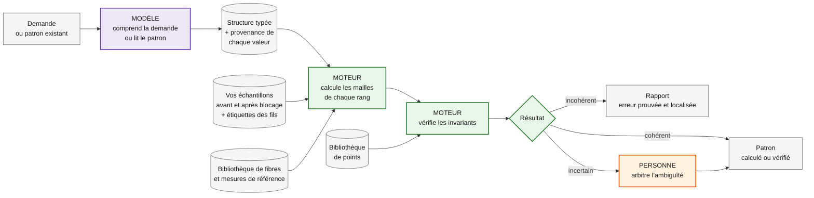
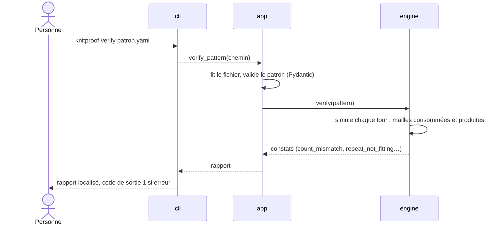
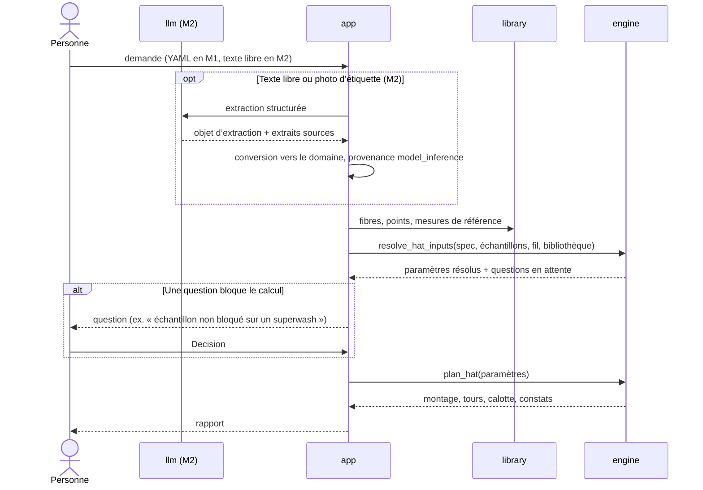
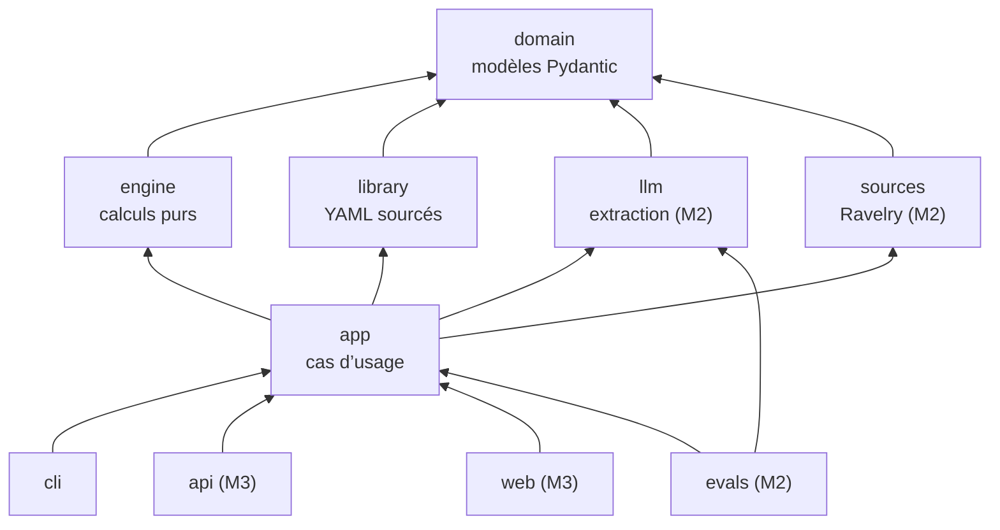

# Architecture de knitproof

> **Le modèle propose, le moteur prouve, la personne arbitre.**

Ce document décrit comment knitproof est construit : qui décide quoi, par où passent les données, comment le code est découpé et pourquoi. Le plan de réalisation est dans [`plan.md`](plan.md), le protocole d’évaluation dans [`evaluation.md`](evaluation.md).

## Sommaire

1. [Vue d’ensemble](#1-vue-densemble)
2. [Qui décide quoi](#2-qui-décide-quoi)
3. [Parcours « vérifier un patron »](#3-parcours--vérifier-un-patron-)
4. [Parcours « calculer un bonnet »](#4-parcours--calculer-un-bonnet-)
5. [Couches](#5-couches)
6. [Modèles de données](#6-modèles-de-données)
7. [Provenance et résolution des sources](#7-provenance-et-résolution-des-sources)
8. [Nombres et arrondis](#8-nombres-et-arrondis)
9. [Représentation d’un patron](#9-représentation-dun-patron)
10. [Sécurité et données](#10-sécurité-et-données)
11. [Limites assumées](#11-limites-assumées)
12. [Décisions à documenter](#12-décisions-à-documenter)
13. [Projets proches](#13-projets-proches)

## 1. Vue d’ensemble



Trois acteurs, trois responsabilités qui ne se recouvrent pas :

- le **modèle** (violet) transforme du texte ou une image en structure typée ; il ne produit jamais un nombre de mailles ni un verdict ;
- le **moteur** (vert) est du Python pur, sans IA : il résout les sources, calcule, simule et vérifie ;
- la **personne** (orange) tranche ce qu’aucun calcul ne peut prouver, et sa décision est enregistrée.

## 2. Qui décide quoi

| Étape | Modèle | Moteur | Personne |
|---|---|---|---|
| Comprendre une demande, lire une étiquette (M2) | propose une structure | valide le schéma, pose la provenance | corrige si besoin |
| Résoudre les paramètres (échantillon, tour de tête, aisance, hauteur) | — | applique la table de résolution | répond aux questions en attente |
| Calculer montage, hauteur, calotte | — | calcule | — |
| Vérifier un patron | — | simule tour par tour, compare | — |
| Contrôler un nombre proposé par un LLM | — | accepte ou rejette, avec le calcul | — |
| Trancher une ambiguïté | — | signale `needs_review` | décide ; la `Decision` est tracée |
| Juger tombé, confort, esthétique | — | — | tricot-test |

## 3. Parcours « vérifier un patron »

En M1, le patron est saisi en YAML ; la lecture d’un patron par un modèle vient après M3.



## 4. Parcours « calculer un bonnet »



## 5. Couches



Une flèche signifie « dépend de ».

| Couche | Rôle | Règles |
|---|---|---|
| `domain` | Modèles de données et invariants | Aucune dépendance interne |
| `engine` | Résolution, calculs, simulation, vérification | Python pur ; aucune lecture de fichier, aucun réseau, aucun appel à un modèle |
| `library` | Chargement des bibliothèques YAML sourcées | Toute valeur a une source |
| `llm` | Objets d’extraction, appels aux modèles, conversion vers `domain` | Jamais importé par `engine` |
| `sources` | Données externes (API Ravelry) | Optionnel : knitproof fonctionne sans |
| `app` | Cas d’usage : `verify_pattern`, `plan_hat` | Seul point d’entrée pour `cli`, `api` et `web` |
| `cli`, `api`, `web` | Portes d’entrée | Aucune logique métier ; rendu uniquement |
| `evals` | Jeux d’évaluation et mesures | Voir [`evaluation.md`](evaluation.md) |

Ces règles sont vérifiées automatiquement par import-linter (CLA-53). L’API JSON et l’interface web sont deux portes vers le même cœur : une interface React séparée reste possible sans toucher au moteur.

## 6. Modèles de données

Modèles Pydantic dans `domain/`. Chacun naît d’un test qui échoue : la liste ci-dessous est une cible, pas un préalable.

### Provenance

| Modèle | Champs clés | Invariants |
|---|---|---|
| `SourceKind` | `user_swatch`, `user_measurement`, `user_input`, `yarn_label`, `ravelry`, `fiber_library`, `reference_measurement`, `model_inference`, `person_decision`, `engine` | pas d’ordre global (voir section 7) |
| `SourceLocation` | `document`, `page`, `line`, `round` | au moins un champ renseigné |
| `Provenance` | `kind`, `reference`, `location`, `extracted_by` (modèle, version, prompt), `note` | `reference` obligatoire pour `fiber_library`, `reference_measurement`, `yarn_label`, `ravelry` |
| `Sourced[T]` | `value`, `provenance` | réservé aux paramètres résolus et aux constats |

### Mesures, fil, fibres

| Modèle | Champs clés | Invariants |
|---|---|---|
| `Range` | `min`, `max` | `min ≤ max` |
| `ReferenceMeasurement` | `quantity` (tour, hauteur), `age_or_size`, `range_cm`, `source` | source obligatoire ; divergence entre sources signalée |
| `FiberComposition` | parts (`fiber_id`, `percent`) | somme = 100 ; fibres connues |
| `YarnLabel` | composition, `needle: Range[NeedleSize]`, `gauge` (fourchette, unité d’origine, état inconnu), `length_m`, `weight_g`, `care`, `superwash` | provenance au niveau de l’objet |
| `Yarn` | `id`, `name`, `brand`, `composition`, `superwash`, `label` | — |
| `FiberProfile` | `fiber_id`, `names`, `blocking_change` (largeur, hauteur), `ease_modifier`, `sources`, `validated_by` | au moins une source ; non validé ⇒ `needs_review` |

### Échantillon et points

| Modèle | Champs clés | Invariants |
|---|---|---|
| `Length` | `value: Decimal`, `unit` (`cm` / `in`) | conversion exacte : 1 in = 2,54 cm |
| `NeedleSize` | `original` (ex. « US 6 », « 4 mm », taille UK ou japonaise), `system` (`mm`, `us`, `uk`, `jp`), `mm: Decimal` | `mm` calculé par la table de correspondance sourcée ; correspondance ambiguë ⇒ `needs_review` |
| `Needle` | `size: NeedleSize`, `kind` (`straight`, `circular`, `double_pointed`), `cable_length: Length` (aiguilles circulaires), `material` (optionnel : métal, bois, bambou…) | `cable_length` obligatoire pour `circular`, absent sinon ; la matière n’entre dans aucun calcul |
| `SwatchMeasurement` | `stitches: Decimal`, `width: Length`, `rows: Decimal`, `height: Length` | valeurs > 0 ; demi-mailles admises (ex. 22,5 m pour 10 cm, 22 m pour 4 in) ; jauge pour 10 cm dérivée |
| `Swatch` | `id`, `yarn_id`, `needle: Needle`, `stitch_pattern_id`, `worked` (`round` / `flat`), `before`, `after`, `blocking_method` | aiguilles et point identiques avant et après, par construction |
| `StitchPattern` | `id`, `names`, `repeat_multiple`, `repeat_offset` | `0 ≤ offset < multiple` |

### Spécification, patron, résultats

| Modèle | Champs clés | Invariants |
|---|---|---|
| `HatSpecification` | `head_cm`, `age_years`, `yarn_id`, `body_swatch_id`, `brim_swatch_id`, `ease`, `brim_pattern_id`, `body_pattern_id`, `brim_height_cm`, `folded_brim`, `total_height_cm`, `crown_sectors`, `worked` (`round` en V0), `needles: list[Needle]` | `head_cm` > 0 ; hauteur du bord < hauteur totale ; les aiguilles permettent la méthode (`round` ⇒ circulaires ou double pointe) |
| `Ease` | `value`, `unit` (% ou cm) | — |
| `ResolvedHatInputs` | tête, jauge, aisance, hauteurs, chacun `Sourced` | seule entrée du calcul |
| `Op` | `work(n)`, `k2tog`, `ssk`, `k3tog`, `sk2p`, `m1`, `finish` ; `consumes` et `produces` dérivés | `consumes ≥ 0`, `produces ≥ 0` |
| `Repeat` | `body`, `times` (entier ou `to_end`) | `to_end` consomme exactement le reste |
| `Round` | `start`, `end`, `ops`, `stated_count`, `section`, `location` | les opérations consomment exactement les mailles du tour précédent |
| `Pattern` | `cast_on`, `rounds`, `provenance` | tours contigus et croissants |
| `CastOnResult` | `target_cm`, `raw_stitches`, `stitches`, `rounding_rule`, `finished_cm`, `adjustment_round` | compatible avec tous les multiples, ou tour d’ajustement explicite |
| `CrownPlan` | `sectors`, `rounds`, `depth_cm` | fin à 0 maille ou fermeture déclarée |
| `HatPlan` | `cast_on`, `brim_rounds`, `body_rounds`, `crown`, `finished_circumference_cm`, `finished_height_cm` | hauteurs calculées avec la jauge en rangs après blocage |
| `Finding` | `status` (`error`, `warning`, `ok`, `needs_review`), `code`, `location`, `message`, `expected`, `actual`, `decided_by`, `provenance` | `error` ⇒ moteur ; `needs_review` ⇒ une question en attente |
| `PendingQuestion`, `Decision` | question, options ; choix, date, motif | toute décision répond à une question |
| `Report` | `findings`, `inputs`, `decisions`, `result`, `engine_version`, `library_version` | déterministe : même entrée, même rapport |

Les modèles d’évaluation (`EvalManifest`, `EvalCase`, `ModelRun`, `FieldScore`, `BaselineRun`) sont décrits dans [`evaluation.md`](evaluation.md).

**Repoussés** : profil de la personne au-delà de l’âge, autres vêtements, élasticité et mémoire des fibres (non consommées par le calcul), quantité de fil, persistance des échantillons (fichiers YAML en M1), tricot à plat, lecture de patrons PDF.

## 7. Provenance et résolution des sources

Trois règles :

1. La provenance est portée par l’objet d’entrée : un `Swatch` vient par nature de l’utilisatrice, un `YarnLabel` de l’étiquette.
2. Quand un modèle a lu la source, la provenance garde la trace de la lecture (`extracted_by`). Elle est posée par le code de l’adaptateur, **jamais déclarée par le modèle**.
3. Une valeur manquante devient une `PendingQuestion`. Elle n’est jamais estimée en silence.

L’ordre de confiance dépend de la grandeur :

| Grandeur | Ordre de confiance | Si rien n’est disponible |
|---|---|---|
| Échantillon | échantillon bloqué > échantillon non bloqué (règle à trancher) > étiquette ou fiche Ravelry (`needs_review`) | question en attente |
| Tour de tête | mesure > mesure de référence par âge (`needs_review` si les sources divergent) | question en attente |
| Aisance | saisie > bibliothèque de fibres validée | question en attente |
| Hauteur | saisie > mesure de référence par âge | question en attente |

Une étiquette et une fiche Ravelry qui divergent produisent un constat `needs_review`. La provenance permet aussi d’effacer sur demande toutes les données venues d’une source, comme l’exige la licence de l’API Ravelry.

## 8. Nombres et arrondis

- Les comptes du patron (mailles sur l’aiguille, numéros de tours) sont des entiers : on monte 88 mailles, pas 88,5.
- Les mesures sont des `Decimal`, y compris les mailles et rangs comptés sur un échantillon, où les demi-mailles sont courantes (22,5 m pour 10 cm). Aucun `float` dans `engine`.
- Chaque longueur garde son unité d’origine. Un échantillon « 22 m pour 4 in » se mesure sur 10,16 cm, pas 10 cm : confondre les deux décale le montage d’environ 1,6 %.
- Les tailles d’aiguilles gardent leur notation d’origine (mm, US, UK, japonaise) ; la valeur en mm vient d’une table de correspondance sourcée dans la bibliothèque. Une correspondance ambiguë devient un constat `needs_review`.
- L’outil et la méthode sont distincts : des circulaires servent à plat comme en rond, des aiguilles droites seulement à plat. La méthode (`worked`) se renseigne sur l’échantillon et sur le projet ; le moteur vérifie que les aiguilles la permettent.
- La matière des aiguilles (métal, bois, bambou…) joue sur la tension et sur la glisse du fil, mais n’entre dans aucun calcul : aucun coefficient inventé. Si les aiguilles du projet diffèrent de celles de l’échantillon, en taille ou en matière, le moteur produit un avertissement `swatch_needle_mismatch` qui invite à refaire l’échantillon.
- Le type d’aiguilles compte pour le tricot en rond : un câble de circulaire trop long pour la circonférence du tricot ne permet pas de tricoter. Le moteur signale le tour de la calotte à partir duquel il faut passer aux aiguilles double pointe ou au magic loop (constat `needle_change`), selon une règle à valider.
- Un seul arrondi métier : celui du montage, avec une règle paramétrée et tracée dans le résultat.
- La mise en forme française (« 43,2 cm ») relève du rendu, pas du domaine.

## 9. Représentation d’un patron

Chaque opération déclare les mailles qu’elle consomme et produit : `k2tog` consomme 2 mailles et en produit 1. Une répétition indique son nombre de passages ou `to_end`. Un tour peut couvrir une plage (« côtes 2/2 sur 20 rangs ») et porte sa localisation dans le document source.

Invariant central : les opérations d’un tour consomment exactement les mailles produites par le tour précédent. Sinon, le moteur produit un constat `repeat_not_fitting`. Un compte annoncé qui diffère de la simulation produit un constat `count_mismatch`.

Esquisse du format YAML (fixé en M1) :

```yaml
cast_on: 108
rounds:
  - {start: 1, end: 30, ops: [{work: 108}]}
  - start: 31
    ops: [{repeat: {body: [{work: 10}, k2tog], times: 9}}]
    stated_count: 99
  - {start: 32, ops: [{work: 99}]}
  - start: 33
    ops: [{repeat: {body: [{work: 9}, k2tog], times: 9}}]
    stated_count: 89
    location: {page: 2, line: 14}
```

En V0, le bonnet se tricote en rond : `Round` suffit. Les patrons français disent souvent « rang » pour un tour.

## 10. Sécurité et données

- Le modèle ne produit que des structures validées par Pydantic. Un texte injecté dans un patron ou une demande ne peut pas changer un compte : le calcul ne dépend que du moteur.
- Les mesures d’un enfant sont enregistrées sans nom.
- Les photos d’étiquettes sont débarrassées de leurs métadonnées EXIF (localisation).
- Stockage local en V0.
- Aucun patron du commerce dans le dépôt ; les patrons gratuits ne sont pas libres de droits.
- Les identifiants d’API (Ravelry, modèles) restent dans un `.env` local, jamais dans le dépôt.

## 11. Limites assumées

Aucun calcul ne remplace un tricot-test : le tombé, le confort, la tenue et l’esthétique restent à juger par une personne. knitproof garantit la cohérence des nombres, pas la réussite du vêtement.

## 12. Décisions à documenter

Les décisions structurantes font l’objet d’un ADR dans [`adr/`](adr/) (CLA-51) :

- Python, uv et les conventions d’OpenGateLLM ;
- format intermédiaire typé avant tout calcul ;
- moteur déterministe, modèle limité à l’extraction ;
- accès aux modèles par une API compatible OpenAI via pydanticAI ;
- `Decimal` et règles d’arrondi ;
- provenance et résolution par grandeur ;
- découpage en couches ;
- mélanges de fibres ;
- interface web : HTMX ou React avec React Aria ;
- contraintes de la licence de l’API Ravelry.

## 13. Projets proches

- [StitchCheck](https://github.com/KingHaim/stitchcheck) vérifie les mailles rang par rang, avec un mode LLM optionnel.
- [knitcheck](https://github.com/jarhodes314/knitcheck) traite le patron comme un programme typé, en Rust.

knitproof part de l’échantillon réel et du comportement des fibres, trace la provenance de chaque valeur, mesure sa fiabilité par modèle et renvoie l’incertain à une personne.
